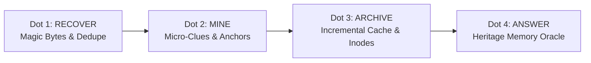

# Forensic Dot Connector

<p align="center">
  
</p>

<p align="center">
  <strong>Forensic Dot Connector = Recover, Mine, Archive, Answer.</strong><br>
  <em>An on-device AI system analyzing micro-clues and heirloom anchors so families pass on their legacy to future generations with confidence.</em>
</p>

<p align="center">
  <a href="https://ugreenhackathon.devpost.com/"></a>
  <a href="#uliya-skill-standard-compliance"></a>
  <a href="#dual-engine-architecture"></a>
  <a href="#hardware-telemetry--privacy"></a>
</p>

---

## Interactive Interface Preview

<p align="center">
  
</p>

---

## Executive Summary & Vision

Every family possesses an archival graveyard: shoeboxes of physical prints, scattered thumb drives, and disparate backups spanning from the 1900s to the present. The timestamps are corrupted by scanner software, the faces are unindexed, and the stories behind the photos are fading with each passing generation.

**Forensic Dot Connector** solves this crisis directly on your **UGREEN AI NAS (UGOS / UGOS Pro)**. It delivers an end-to-end media recovery and intelligence pipeline that operates entirely on-device, preserving family sovereignty and memory provenance forever.

The system is anchored by the **4-Dot Formula**:

$$\text{Forensic Dot Connector} = \mathbf{Recover} \longrightarrow \mathbf{Mine} \longrightarrow \mathbf{Archive} \longrightarrow \mathbf{Answer}$$



---

## The Four Pillars (The 4 Dots)

### 🟢 Dot 1: Recover (Pre-Ingestion Media Recovery & File Triage)
* **Magic Byte Validation**: Inspects raw byte signatures (JPEG `FF D8 FF`, TIFF `49 49 2A 00` / `4D 4D 00 2A`, PNG, HEIC) to quarantine corrupted transfers and zero-byte scans before running model inference.
* **Storage Deduplication**: Automatically groups byte-for-byte identical scans and redundant cloud backups via `ug-filemgr scan-dedupe`.
* **Hardware Inode Synchronization**: Once chronological anchors are verified, synchronizes filesystem metadata via `ug-filesystem chtimes` behind a strict **Human-in-the-Loop Confirmation Gate**.

### 🔵 Dot 2: Mine (Deep Forensic Mining & Multi-Modal Anchoring)
Chronological dating is treated as **one mined attribute** among rich physical, cultural, and biometric evidence:
* **Heirloom Anchors**: Recognizes persistent family items—such as Grandfather's 1958 Omega Constellation watch—to establish mathematical lower bounds ($T_{min} \ge 1958$).
* **Biographical Markers**: Indexes persistent physical traits (tattoos, piercings), temporary medical events (orthopedic casts and crutches yielding 4–10 week micro-windows), and grooming eras (mustache transitions).
* **Life Objects & Milestone Sequence**: Automatically sequences children's bicycles, tricycles, pet adoptions, and graduation regalia to resolve milestone debates.
* **Print Chemistry & Physical Forensics**: Detects scalloped/deckled photo edges (1938–1956), photo lab margin developer stamps, Kodak/Fujifilm paper watermarks, Polaroid chemistry pods, and orange 35mm date backs.
* **Manufactured Lifecycles**: Correlates automotive chassis, consumer electronics, and home appliances against verified historical release timelines.

### 🟡 Dot 3: Archive (Incremental Cache Pipeline & Sovereign Storage)
* **Two-Tier Delta Cache**: Evaluates directory-level `mtime` and `size` headers to bypass already-processed photos without disk re-reads.
* **Delta Hash Pipeline**: When timestamps change, computes high-speed BLAKE3/xxHash hashes in `@appcache` to index only net-new files.
* **Persistent Inode Registry**: Maintains chronological graph records in `@appdata/chronology.db` with absolute transaction durability.

### 🟣 Dot 4: Answer (Conversational Family Heritage Oracle)
* **Natural-Language Genealogical Queries**: Answers emotional family inquiries with side-by-side photographic evidence:
  * *"Who got a bike first, Sam or Pat?"*
  * *"What year did Mom get our first cat?"*
  * *"Show me Grandfather's timeline before he moved to Chicago."*
* **Sovereign Privacy**: Executes 100% locally on the UGREEN NAS NPU and CPU via UGOS native agents. Zero external telemetry, zero subscription fees.

---

## Dual-Engine Architecture

Forensic Dot Connector is built with a decoupled dual-engine architecture:

```
┌─────────────────────────────────────────────────────────────────────────────┐
│                       UGREEN AI NAS (UGOS / UGOS Pro)                       │
├──────────────────────────────────────┬──────────────────────────────────────┤
│    Native UGOS App Platform (UPK)    │     Uliya AI Conversational Skill    │
│    ID: com.pellerano.forensicdot     │        Name: forensic-dot-connector  │
├──────────────────────────────────────┼──────────────────────────────────────┤
│ • project.yaml (Spec v2.1)           │ • SKILL.md (Uliya Standard)          │
│ • React 18 + Vite + TypeScript UI    │ • 6 Specialized Reference Guides     │
│ • Multi-arch daemons (amd64/arm64)   │ • Static-pass (0 errors, 0 warnings) │
│ • Embedded hardware telemetry bridge │ • Zero binaries / pure agent rules   │
└──────────────────────────────────────┴──────────────────────────────────────┘
                                  │
                                  ▼
        ┌─────────────────────────────────────────────────────┐
        │            Local Hardware UGOS Agent Mesh           │
        ├──────────────────────────┬──────────────────────────┤
        │  ug-filesystem / filemgr │  ug-photo / knowledge    │
        │  (Storage & Inode sync)  │  (Vision VLM & RAG DB)   │
        └──────────────────────────┴──────────────────────────┘
```

---

## Verified UGOS Capability Catalog Mapping

Every operation maps to documented UGOS agent capabilities verified against the official UGREEN SDK:

| Agent | CLI Family | Capability Action | Operational Purpose |
| :--- | :--- | :--- | :--- |
| **file-agent** | `ug-filesystem` | `find` | Scans directories for untriaged image extensions |
| **file-agent** | `ug-filesystem` | `stat` | Extracts low-overhead inode `mtime` and byte size |
| **file-agent** | `ug-filesystem` | `chtimes` | **Human-gated**: updates filesystem creation/mod times |
| **file-agent** | `ug-filemgr` | `scan-dedupe` | Discovers identical duplicate scans across pools |
| **file-agent** | `file-workflow`| `batch-move` | Relocates corrupted images to quarantine folder |
| **photo-agent**| `ug-photo` | `vision-vlm` | Mines micro-clues (watches, appliances, hairstyles) |
| **photo-agent**| `ug-photo` | `vision-ocr` | Extracts printed calendar text and lab timestamps |
| **photo-agent**| `ug-photo` | `meta` | Reads and writes EXIF/XMP sidecar metadata |
| **photo-agent**| `ug-photo` | `timeline` | Organizes media into chronological event streams |
| **photo-agent**| `ug-photo` | `create-album`| Compiles recovered family milestone collections |
| **photo-agent**| `ug-photo` | `figure-albums`| Groups recurring ancestors across decades |
| **knowledge-agent**|`ug-knowledge`| `save-text` | Persists forensic dossiers into local RAG storage |
| **knowledge-agent**|`ug-knowledge`| `process-materials`| Indexes family chronology for conversational recall |

---

## Retinal Gallery (7-Tab Native Interface with 3D Command Center)

<p align="center">
  
  <br>
  <em>Figure 7: Command Center: 3D Sovereign Heritage Globe powered by the ProofGate 3D Engine — featuring OrbitControls, Great Circle migration trajectory arcs, and Day/Night solar terminator illumination.</em>
</p>

| 01. Recovery & Triage | 02. Forensic Mining Matrix |
| :---: | :---: |
|  |  |
| **03. Family Heritage Oracle** | **04. Century Clue Taxonomy** |
|  |  |
| **05. Incremental Cache Queue** | **06. NAS Agent Telemetry** |
|  |  |

---

## Uliya Skill Standard Compliance

The conversational AI skill package complies strictly with the **Uliya Skill Standard**:

```bash
$ node uliya-skill-kit/scripts/check-skill.mjs skill/forensic-dot-connector

{
  "status": "static-pass",
  "skill": "forensic-dot-connector",
  "errors": 0,
  "warnings": 0,
  "info": 0
}
```

* **Zero External Executables**: Pure Markdown skill package with 6 deep reference guides.
* **Package Size**: 16.5 KB (well within the 10 MB hackathon package limit).
* **Strict Human-in-the-Loop Safety**: All mutating filesystem modifications (`chtimes`, album generation, dossier writes) require explicit user approval before execution.

---

## Repository Directory Layout

```
.
├── README.md                                    # Master project documentation & architecture
├── .gitignore                                   # Ignore node_modules, build caches, test captures
│
├── Project/com.pellerano.forensicdot/           # Native UGOS Application Source
│   ├── project.yaml                             # UGOS spec v2.1 manifest (nasync + homeagent)
│   ├── Forensic-Dot-Connector-Proposal.pdf      # Official 2-page project proposal (<= 1MB)
│   ├── forensic-dot-connector.zip               # Static-pass Uliya skill package (16.5 KB)
│   ├── rootfs_common/
│   │   ├── icon.png                             # 256x256 4-dot application icon
│   │   └── www/                                 # Vite + React 18 + TS Forensic Dashboard
│   │       ├── src/App.tsx                      # 6-tab forensic interface with state machines
│   │       ├── packages/@ugreen-nas/builder-open# Local UGOS builder stub
│   │       └── package.json
│   ├── rootfs_amd64/                            # x86_64 native binaries & service hooks
│   ├── rootfs_arm64/                            # ARM64 native binaries & service hooks
│   └── skill/forensic-dot-connector/            # Unpacked Uliya Skill Package
│       ├── SKILL.md                             # Core orchestration prompt & capability router
│       └── references/                          # 6 forensic taxonomies & safety protocols
│
└── UGREEN DOCS - IDEAS/                         # Submission Artifacts & Visual Proof
    ├── Devpost-Project-Description.md           # Grand-prize standard Devpost story
    ├── Forensic-Dot-Connector-Proposal.pdf      # Mirrored submission proposal
    ├── forensic-dot-connector.zip               # Mirrored skill package
    ├── uliya-skill-kit/                         # Official UGREEN validator toolchain
    └── demo-media/                              # Visual assets for Devpost & gallery
        ├── icon.png                             # 4-dot logo (Recover, Mine, Archive, Answer)
        ├── forensic_dot_connector_demo.gif      # Full 6-tab animated product walkthrough
        ├── forensic_dot_connector_demo.mp4      # High-definition H.264 video demo
        └── 01_recovery_and_triage.png...        # 6 High-resolution Retina UI captures
```

---

## Build & Local Development

### 1. Build the Native UGOS Dashboard
```bash
cd Project/com.pellerano.forensicdot/rootfs_common/www
npm install
npm run build
```

### 2. Validate the Skill Package
```bash
node "UGREEN DOCS - IDEAS/uliya-skill-kit/scripts/check-skill.mjs" "Project/com.pellerano.forensicdot/skill/forensic-dot-connector"
```

### 3. Package Official UGOS UPK Bundles (using ugcli)
```bash
cd Project/com.pellerano.forensicdot
ugcli check
ugcli pack --arch all --build 1 --product-series all
```

---

## Author & Acknowledgements

* **Entrant / Lead Architect**: Francisco Pellerano (`@ciscojrai`)
* **Hackathon**: [UGREEN Hackathon 2026 on AI NAS](https://ugreenhackathon.devpost.com/)
* **Category Track**: Bring Memories to Life
* **Project Pitch**: *Recover, Mine, Archive, Answer.*
